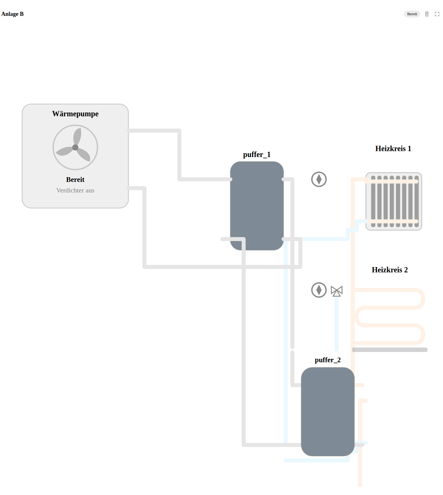

# Hydraulic Plan Card

Eine übersichtliche Heizungsanzeige für Home Assistant – von der Wärmepumpe bis zum Heizkreis.

Die Karte basiert auf der [Heat Pump Hydraulic Card von Sturmi77](https://github.com/Sturmi77/heatpump-hydraulic-card) und erweitert sie um weitere Wärmeerzeuger und frei kombinierbare Anlagenteile.



Die Vorschau zeigt eine der automatisiert geprüften Beispielanlagen. Je nach angeschlossenen
Wärmeerzeugern, Speichern und Heizkreisen sieht die Darstellung unterschiedlich aus.

## Was kann die Karte?

- **Wärmeerzeuger:** Wärmepumpen, Öl-, Gas-, Pellet-, Holzvergaser- und Hackschnitzelkessel
- **Speicher:** Puffer- und Warmwasserspeicher, auch mehrere hintereinander
- **Heizkreise:** Heizkörper, Fußbodenheizung, Pumpen und Mischer
- **Hydraulik:** Verbindungen, Ladepumpen, Umschaltventile und Rücklaufanhebung
- **Live-Anzeige:** Temperaturen, Betriebszustände und animierte Leitungen

Die Karte lässt sich im visuellen Editor einrichten. Für unterstützte Integrationen kann sie vorhandene Messwerte vorschlagen, unter anderem mithilfe der Wärmepumpen-Erkennung der Originalkarte. Du entscheidest, welche Zuordnungen übernommen werden.

## Installation

1. In **HACS** ein benutzerdefiniertes Repository hinzufügen: `https://github.com/BlueIceWolf/ha-hydraulic-plan-card`
2. Als Typ **Dashboard** auswählen und **Hydraulic Plan Card** installieren.
3. Home Assistant im Browser neu laden und eine neue Karte hinzufügen.

Minimale Konfiguration:

```yaml
type: custom:hydraulic-plan-card
```

Im Karteneditor Wärmeerzeuger, Speicher und Heizkreise hinzufügen, ihre tatsächlichen Anschlüsse verbinden und passende Home-Assistant-Entitäten auswählen.

**Ohne HACS:** [JavaScript-Datei](dist/ha-hydraulic-plan-card.js) nach `/config/www/` kopieren und `/local/ha-hydraulic-plan-card.js` als JavaScript-Modul unter Dashboard-Ressourcen eintragen.

## Gut zu wissen

Die Farben orientieren sich an den zugeordneten Temperaturen. Bewegte Punkte in den Leitungen zeigen einen **aus Sensor- und Pumpenzuständen abgeleiteten Durchfluss** an – keine direkte Durchflussmessung. Die Karte dient nur zur Anzeige, nicht zur Steuerung oder als Sicherheitseinrichtung.

**Noch in Entwicklung:** Es handelt sich um eine Alpha-Version. Nicht jede Anlagenkombination ist vollständig geprüft. Sichere deine Kartenkonfiguration vor Updates.

## Hilfe und Rückmeldungen

Wenn etwas nicht richtig dargestellt wird, erstelle bitte ein [GitHub-Issue](https://github.com/BlueIceWolf/ha-hydraulic-plan-card/issues) mit Screenshot, Kartenversion und möglichst einer anonymisierten Konfiguration.

Weitere Informationen: [Komponenten und Anschlüsse](docs/FREE_PLAN.md) · [Geräte und Messwerte](docs/BOILERS.md) · [English](docs/README.en.md)

## Danke

Die Grundlage stammt von [Sturmi77](https://github.com/Sturmi77/heatpump-hydraulic-card). Dieses Projekt führt die Karte unter der [MIT-Lizenz](LICENSE) weiter und ist kein offizieller Teil des Originalprojekts.
